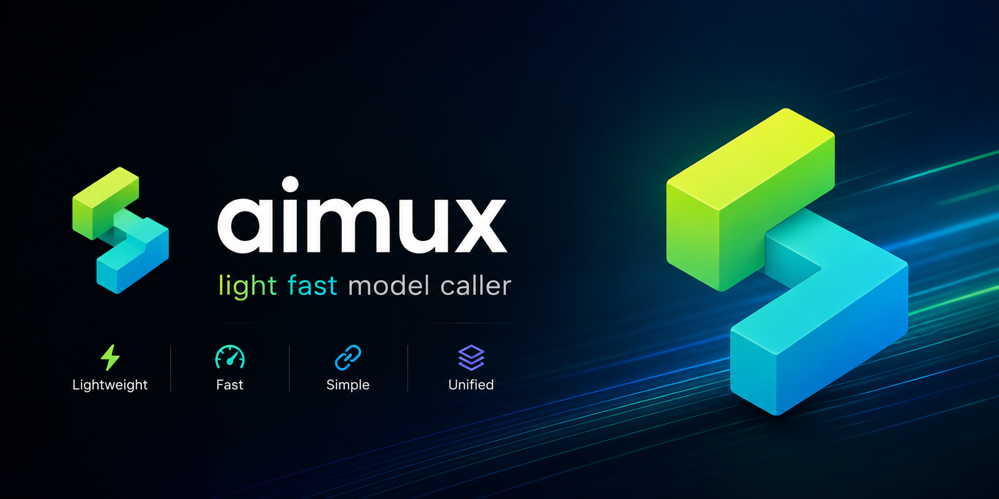

# aimux (arcships)

<p align="center">
  
</p>

<p align="center">
  <a href="README.md">English</a> · <a href="README.zh-CN.md">简体中文</a>
</p>

**aimux 是进程内嵌的 SDK：一个 Rust 核心、一套调用方式，覆盖 300+ 个服务商名称，并提供八种语言绑定。**

它链接进你的进程，直接请求各服务商的 HTTP API。它不是代理网关，也不包含 Agent 循环、RAG 或编排。

> **0.6.0 是破坏性版本。** 所有绑定使用同一套操作 ABI（ABI 1 / ops 1.0）。对外 JSON 对齐 Vercel AI SDK V4（字段 camelCase，联合类型使用 AI SDK 的标签）。从 0.5 迁移前请读 [升级指南](docs/upgrading-to-0.6.md)。绑定里的 0.5 辅助函数（`generateText`、`Model.openai`、`NewOpenAI`、`aimux_openai_new`）已删除。Rust 的 `openai()` 和 `generate_text` 仍在。

| | |
|---|---|
| 语言 | Rust、Node.js、Python、Go、Java、Kotlin、Swift、Flutter、C/C++ |
| 服务商 | 300+ 个名称。精确名单由生成文档给出：[docs/api/providers.md](docs/api/providers.md) |
| 离线测试 | `aimux-providers/tests/cassettes` 下 2,797 个 JSON cassette |
| 许可证 | [MIT](LICENSE) |

[FAQ](FAQ.md) · [示例](examples/) · [llms.txt](llms.txt) · [API 总览](docs/API.md) · [英文 README](README.md)

## 它是什么，不是什么

- **是**进程内的接入层。调用方持有 `LanguageModel`（Rust）或 `provider.create` → `provider.model` → `text.generate` / `text.stream`（各语言绑定），由本进程发出 HTTP 请求。
- **不是** LiteLLM Proxy、OpenRouter 这类你要单独部署或付费调用的网关。仓库里的 `litellm_proxy` 和 `openrouter` 只是 aimux 可以去调用的服务商预设。
- **不是** LangChain、rig 或 Mastra 那种编排框架。工具由调用方执行；aimux 不跑多步 Agent 循环。

八种绑定共用一个 Rust 核心：Node.js（napi-rs）、Python（PyO3）直连核心；Swift、Kotlin、Flutter、Go、Java、C/C++ 走 C ABI。Swift、Kotlin、Flutter 覆盖移动端。

## 快速开始（0.6.0）

Rust。`openai()` 在真正发请求时读取 `OPENAI_API_KEY`。`chat` 走 Chat Completions；该包的 `language_model` 选择 Responses API。

```rust
use aimux_core::prelude::*;
use aimux_providers::openai::openai;

#[tokio::main]
async fn main() -> Result<(), AiMuxError> {
    let model = openai().chat("gpt-4o");
    let result = generate_text(
        &model,
        "用一句话解释 Rust 的所有权。",
        GenerateTextOptions::default(),
    )
    .await?;
    println!("{}", result.text());
    Ok(())
}
```

```bash
cargo add aimux-core aimux-providers
```

Node.js：`npm install @arcships/aimux`

```typescript
import { Client, LanguageModel } from '@arcships/aimux'

const client = new Client()
const provider = await client.provider({
  package: 'deepseek',
  settings: { apiKey: process.env.DEEPSEEK_API_KEY },
})
const model = await provider.model('deepseek-chat', 'languageModel')
if (!(model instanceof LanguageModel)) throw new Error('Expected LanguageModel')
try {
  console.log((await model.generate('用一句话解释 Rust 的所有权。')).text)
} finally {
  await model.close()
  await provider.close()
}
```

换服务商只改 `package` 和 `modelId`。Python、Go、Java、Kotlin、Swift、Flutter、C 使用相同的三个操作名。可运行的 Rust 程序见 [examples/](examples/)。

## 国内服务商：同一套 API

下面这些名字都在当前代码里。没有单独的 `qwen` 包；通义千问走 DashScope 的 OpenAI 兼容预设。模型 ID 使用各服务商文档中的 ID；下表里的 ID 是本仓库测试实际传入的值。

| 你要调的服务 | `package` | 密钥环境变量 | 测试里用过的模型 ID |
|---|---|---|---|
| DeepSeek | `deepseek`（独立厂商包，另有 `deepseek()` / `create_deepseek`） | `DEEPSEEK_API_KEY` | `deepseek-chat` |
| 通义千问 / Qwen（阿里云 DashScope 国际站） | `alibaba` | `ALIBABA_API_KEY` | `qwen-plus`、`qwen-max` |
| 通义 Coding Plan（中国站） | `alibaba_coding_plan_cn` | `ALIBABA_CODING_PLAN_API_KEY` | — |
| 智谱 | `bigmodel` 或 `zhipu_v4` | `BIGMODEL_API_KEY` 或 `ZHIPU_API_KEY` | `zhipuai_coding_plan` 的测试使用 `glm-4.5-air` |
| Kimi（Moonshot 国际站） | `kimi` | `MOONSHOT_API_KEY` | 注册表列出 `kimi-k*`、`moonshot-v1-*` |
| Kimi / Moonshot 中国站 | `moonshotai`（`https://api.moonshot.cn/v1`） | `MOONSHOT_API_KEY` | 测试使用 `moonshot-v1-8k` |

Rust 换到 DeepSeek：

```rust
use aimux_core::prelude::*;
use aimux_providers::{PresetSettings, create_provider};

let provider = create_provider("deepseek", PresetSettings::default())?;
let model = provider.language_model("deepseek-chat")?;
let result = generate_text(model.as_ref(), "你好", GenerateTextOptions::default()).await?;
println!("{}", result.text());
```

通义千问把 `"deepseek"` 换成 `"alibaba"`，模型 ID 换成 DashScope 上的 Qwen ID（测试使用 `qwen-plus`）。智谱用 `"bigmodel"` 或 `"zhipu_v4"`，Kimi 用 `"kimi"` 或 `"moonshotai"`。绑定侧对应 `provider.create` 的 `package` 字段。

完整名单与每个名字的 base URL、鉴权方式见 [docs/api/providers.md](docs/api/providers.md)。该文件由 `scripts/gen_providers_doc.py` 生成，是服务商数量的唯一精确来源。公开文案写「300+」，避免 README 和 GitHub 简介里的数字再彼此漂移。

## 语言绑定

| 绑定 | 获取方式 |
|---|---|
| Node.js | `npm install @arcships/aimux` |
| Python | `pip install arcships-aimux` |
| Go | `go get github.com/arcships/aimux/bindings/go`，然后 `go generate` |
| Java | Maven Central `ai.arcships:aimux-java` |
| Kotlin | Maven Central `ai.arcships:aimux-kotlin` |
| Swift | 从检出的 `bindings/swift` 添加本地 Swift 包 |
| Flutter | pub.dev 上的 `aimux`（发布者 `arcships.ai`），iOS / Android 带上原生库 |
| C / C++ | GitHub Releases 中的动态库和 `aimux.h` |

各语言的当前 API 与限制见 [bindings/README.md](bindings/README.md) 和 [docs/api/](docs/api/)。

## 记录与回放

Rust 可以用 `init_recording` 把每次请求与响应写入 JSONL，再用 `aimux-replay` 离线重放。密钥在落盘前脱敏。测试不访问网络：`aimux-providers/tests/cassettes` 下有 2,797 个 JSON cassette。

## 文档

| 文档 | 内容 |
|---|---|
| [FAQ.md](FAQ.md) | 它是什么、和网关的差别、语言与服务商、工具调用是否统一、许可证、版本 |
| [examples/](examples/) | 三个可编译的 Rust 示例：对话、流式、切换服务商 |
| [docs/upgrading-to-0.6.md](docs/upgrading-to-0.6.md) | 0.6 迁移 |
| [docs/API.md](docs/API.md) | API 总览 |
| [docs/api/providers.md](docs/api/providers.md) | 生成的服务商名单 |
| [README.md](README.md) | 英文 README（含性能数字与 RFC 索引） |

性能数字只写在 [docs/PERF-RESULTS.md](docs/PERF-RESULTS.md) 和英文 README 里，这里不另抄一份。

## 许可证

[MIT](LICENSE)
